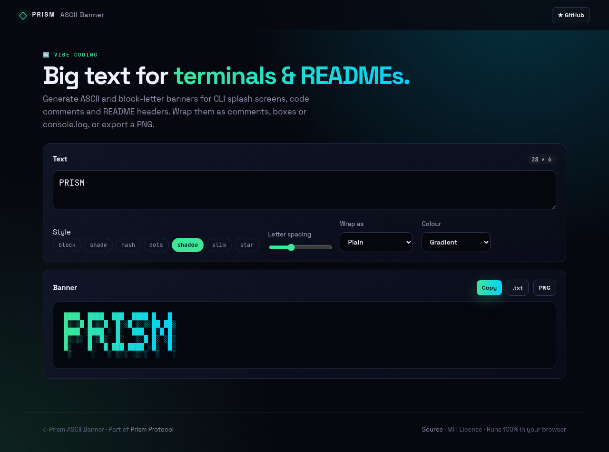
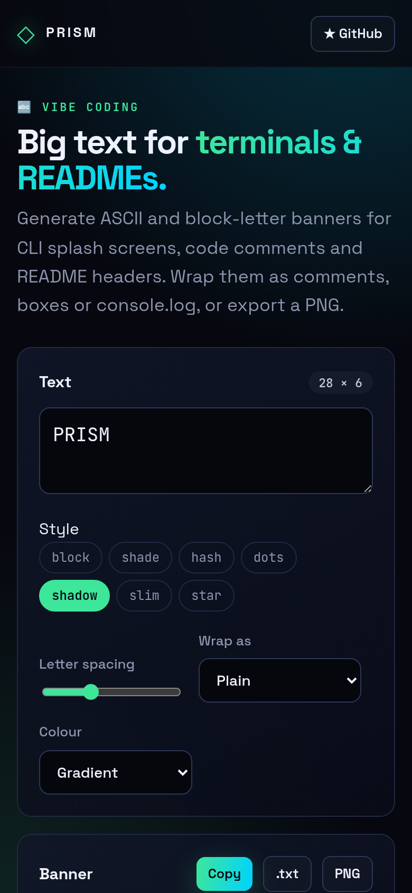

<!-- ═════════════ HEADER ═════════════ -->
<p align="center">
  
</p>

<p align="center">
  
</p>

<p align="center">
  <a href="https://github.com/krishyaa06/prism-ascii-banner/actions/workflows/ci.yml"></a>
  <a href="https://krishyaa06.github.io/prism-ascii-banner/"></a>
  
  
  <a href="LICENSE"></a>
</p>

<p align="center">
  
</p>


## ⚡ Overview

**Prism ASCII Banner** turns text into big block letters for places that only accept plain text: CLI splash screens, file headers, Discord code blocks and README headers. Pick one of seven styles (block, shadow, shade, hash, dots, slim, star), adjust letter spacing, wrap the result in `//`, `#`, `/* */`, an HTML comment, a box, a Markdown code fence or a `console.log()` call, then copy it or save it as text or PNG.

## ✨ Features

- **Built-in 5-row bitmap font** — A–Z, 0–9 and common symbols, multi-line text
- **7 styles** including a drop-shadow mode
- **8 wrappers**: plain, box, `//`, `#`, `/* */`, HTML comment, Markdown fence, `console.log()` (escaped)
- **Letter spacing** control and live dimensions
- **Export** to clipboard, `.txt` or **PNG** (gradient / mono / terminal green)
- Warns about unsupported characters

## 📸 Screenshots

<table>
  <tr>
    <td width="68%"></td>
    <td width="32%"></td>
  </tr>
</table>

## 🚀 Quick Start

**Use it online:** [https://krishyaa06.github.io/prism-ascii-banner/](https://krishyaa06.github.io/prism-ascii-banner/)

**Run locally:**

```bash
git clone https://github.com/krishyaa06/prism-ascii-banner.git
cd prism-ascii-banner
# open index.html in your browser, or serve it:
npx serve .
```

## 🛠️ Usage

Type your text (use new lines for multi-line banners), choose a style and wrapper, then **Copy**, download **.txt** or **PNG**.

## 📁 Project Structure

```
prism-ascii-banner/
├── assets/
│   ├── logo.png
│   └── logo.svg
├── css/
│   ├── app.css
│   └── prism.css
├── js/
│   ├── app.js   # UI + PNG export
│   ├── core.js   # font, renderer, wrappers — tested in Node
│   └── prism.js
├── test/
│   └── core.test.js
├── .gitignore
├── LICENSE
├── index.html
└── package.json
```

## 🧪 Tests

```bash
npm test
```

Tests use the built-in `node:test` runner, so there is nothing to install. CI runs them on Node 20 and 22.

## 🤝 Contributing

1. Fork the repo and create a branch: `git checkout -b feature/my-idea`
2. Make your change and add a test in `test/`
3. Run `npm test` and open a Pull Request

## 🔷 Part of Prism Protocol

Prism ASCII Banner is one of the open-source tools built by [Prism Protocol](https://dc.gg/prismprotocol), a tech community where young builders learn, ship and compete together.

## 👤 Author

<table>
  <tr>
    <td align="center">
      <a href="https://github.com/krishyaa06"><br><b>Soumya Bhandare</b></a><br>
      <sub>Founder @ Prism Protocol</sub>
    </td>
    <td>
      <a href="https://dc.gg/prismprotocol"></a><br>
      <a href="https://instagram.com/prism_protocol_"></a><br>
      <a href="https://x.com/krishyaa06"></a>
    </td>
  </tr>
</table>

## 📄 License

Released under the [MIT License](LICENSE).

<p align="center">
  <b>If you like this project, consider giving it a ⭐</b><br>
  <sub>"Build. Create. Compete." · Made with ⚡ by Prism Protocol</sub>
</p>


